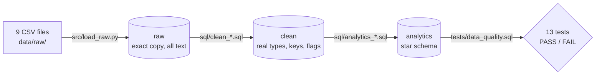

# Olist Customer Experience Analytics

Olist is a Brazilian online marketplace. Acting as an analyst for its customer
experience team, this project uses 99,441 real orders to find what goes together
with unhappy customers (1-2 star reviews) across delivery, products, sellers and
price, and whether unhappy customers are less likely to order again. The end result
is a short list of changes **worth testing**, each with a suggested way to test it.

**Question:** what is linked with unhappy customers on Olist, and which of those
things would be worth testing a fix for first?
Full plan: patterns, KPIs, scope and limitations in [docs/problem_brief.md](docs/problem_brief.md).

> 🚧 Work in progress: Phases 0-4 done; next is **Phase 5 (seller prioritisation with PuLP)**.

## Findings so far (Phases 3-4)

These are patterns in past orders (things that go together), not proof of causes.

- **Late delivery has the strongest link found:** 9.31% of on-time orders were unhappy,
  against 79.36% of orders 8+ days late. Many late orders were rated before the parcel arrived.
- **Most late deliveries had the seller hand over on time** (77.65%). The carrier part was the long one.
- **Even on-time orders show product signals:** office furniture had 17.15% unhappy against
  8.48% for all on-time single-product orders, and unhappy comments mention missing parts, wrong items and damage.
- **Unhappy orders hold 17.46% of reviewed order value** while being 14.73% of reviewed orders.

**Checked against chance (Phase 4):**
- **Lateness:** among customers who rated after the parcel arrived, late orders were unhappy
  **2.10× as often** (95% interval 1.91-2.30).
- **Speed:** on-time deliveries taking 22+ days were unhappy 2.12× as often as 0-7 day ones (1.98-2.27).
- **Categories and sellers:** 12 of 26 categories and 24 of 393 sellers differ from the usual rate
  after correcting for many tests.
- **Repeat orders:** unhappy customers ordered again 0.74× as often within 180 days (0.60-0.91).
- **Value:** the unhappy share of order value is 17.46%, with an interval of 17.03-17.92%.

Full summaries, with every count and its limitations: [docs/phase3_findings.md](docs/phase3_findings.md)
(patterns) and [docs/phase4_statistics.md](docs/phase4_statistics.md) (tests and intervals).

## Data

"Brazilian E-Commerce Public Dataset by Olist" on Kaggle
([`olistbr/brazilian-ecommerce`](https://www.kaggle.com/datasets/olistbr/brazilian-ecommerce)),
licence CC BY-NC-SA 4.0. The data is **not** stored in this repo: you download it yourself (below).

9 CSV files, ~126 MB in total. The orders table has 99,441 rows
(counted with `src/check_raw_files.py`).

## How to set it up (Windows, PowerShell)

Needs Python 3.14, PostgreSQL 18 and a free Kaggle account.

```powershell
# 1. Get the code and build the private Python setup
git clone https://github.com/RishitheB0T/olist-customer-experience-analytics.git
cd olist-customer-experience-analytics
python -m venv .venv
.\.venv\Scripts\python.exe -m pip install -r requirements.txt

# 2. Database settings: copy the template, then type your own password into .env
Copy-Item .env.example .env
.\.venv\Scripts\python.exe -m src.create_database

# 3. Log in to Kaggle (opens a browser), then download the data
.\.venv\Scripts\kaggle.exe auth login
.\.venv\Scripts\kaggle.exe datasets download olistbr/brazilian-ecommerce -p data/raw --unzip

# 4. Check all 9 files arrived
.\.venv\Scripts\python.exe -m src.check_raw_files

# 5. Build everything (raw -> clean -> analytics) and run the data quality tests (~2.5 min)
.\.venv\Scripts\python.exe -m src.pipeline
```

## Pipeline

One command, `python -m src.pipeline`, rebuilds the whole database in PostgreSQL and then tests it.
Add `--skip-raw` to reuse the raw tables already loaded (~35 s instead of ~2.5 min).



- **raw:** the CSV files as they are; every row count is checked against its file.
- **clean:** real data types, primary and foreign keys, and `flag_...` columns for odd rows. **Nothing is deleted.**
- **analytics:** a star schema for analysis and Power BI. All 8 SQL builds run in one transaction: if one fails,
  nothing changes.
- **tests:** each test counts rows that break a rule; the pipeline stops if any test fails.

| Analytics table | One row per |
|---|---|
| `fact_order` | order: delivery days, lateness, amount paid, the chosen review, distance |
| `fact_order_item` | item: price, delivery fee and its share of the price, the seller's own hand-over |
| `dim_customer`, `dim_seller` | customer / seller, with city, state and map point |
| `dim_product` | product, with English category and size |
| `dim_date` | calendar day (2016-2018) |

Every problem found in the data, and the rule used for it, is in
[docs/data_quality_report.md](docs/data_quality_report.md).

## Analysis

Each business question is a saved SQL file in `sql/questions/` (baseline, P1-P5 from the
[problem brief](docs/problem_brief.md), and a rough check of review comments). Run one, or rerun the notebook:

```powershell
# One question file: prints each query's result as a table
.\.venv\Scripts\python.exe -m src.run_sql sql/questions/01_p1_delivery_promise.sql

# The notebook (monthly trends, states, categories, odd values), run top to bottom
.\.venv\Scripts\jupyter.exe nbconvert --to notebook --execute --inplace notebooks/01_trends_and_breakdowns.ipynb
```

**Kaggle notebook (K1):** [What is linked with unhappy Olist customers?](https://www.kaggle.com/code/rishikeshkallapally/what-is-linked-with-unhappy-olist-customers)
(source in [`kaggle/k1_unhappy_customers/`](kaggle/k1_unhappy_customers/)) answers the main
questions with DuckDB straight from the raw CSV files, because Kaggle can't reach PostgreSQL. Its results match the
PostgreSQL pipeline exactly.

## Tech stack

- **Used so far:** Python, pandas, PostgreSQL, SQLAlchemy, DuckDB, SciPy, Jupyter, matplotlib, Git/GitHub, Kaggle.
- **Planned:** PuLP, Power BI, Excel, Docker Compose, GitHub Actions, Azure Data Factory, Databricks (PySpark).
- **Optional extras:** an LLM (free tier or local), scikit-learn.

## Project plan

| Phase | What | Status |
|---|---|---|
| 0 | Setup | ✅ Done |
| 1 | Business question & KPIs | ✅ Done |
| 2 | Clean data (raw → clean → star schema) | ✅ Done |
| 3 | SQL + Python analysis, Kaggle notebook | ✅ Done |
| 4 | Statistics (hypothesis tests, confidence intervals) | ✅ Done |
| 5 | Seller prioritisation under a budget (PuLP) | Next |
| 6 | Power BI dashboard + Excel workbook | — |
| 7 | Recommendations (memo, slides, A/B test designs) | — |
| 8 | Docker Compose | — |
| 9 | GitHub Actions CI/CD | — |
| 10 | Azure Data Factory + Databricks (PySpark) | — |
| 11 | *Optional:* AI tagging of review comments (LLM vs hand labels) | — |
| 12 | *Optional:* predicting 1-2 star orders before delivery | — |

## Folder structure

```
data/raw/     raw CSVs (not on GitHub)
sql/          SQL scripts: profile_* (raw checks), clean_* and analytics_* (builds), check_* (results)
sql/questions/  Phase 3 business questions (baseline, P1-P5, review comments)
src/          Python pipeline code (pipeline.py runs everything)
notebooks/    Jupyter notebooks (trends and breakdowns, with charts)
kaggle/       Kaggle notebooks, one folder per milestone
dashboards/   Power BI files
docs/         problem brief, data quality report, Phase 3 findings, Phase 4 statistics, glossary, memo
tests/        data quality tests (data_quality.sql)
```
